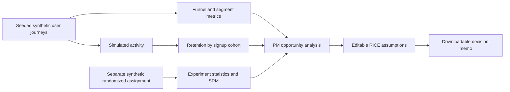

# Architecture and metric lineage

## Tracking contract for a future real product

| Event | Grain | Required properties | Example trigger |
|---|---|---|---|
| landing_viewed | user or anonymous ID | timestamp, device, channel | Landing page view |
| account_created | user ID | timestamp, acquisition source | Completed registration |
| workspace_shared | user ID + workspace ID | timestamp, invited_member_count | First collaboration milestone |
| subscription_started | user ID | timestamp, plan, billing period | First paid conversion |
| core_action_completed | user ID + workspace ID | timestamp | Meaningful repeat usage |

In production, deduplicate events by stable event IDs, apply timezone and late-arrival policies, ensure users enter a funnel at most once per stage, and verify timestamp order.

## Retention semantics

The demo's cohort label is **signup week**. The denominator is users who ultimately activated in that signup cohort. Week 0 is each activated user's synthetic first activity, and week N is synthetic activity N weeks after activation. This is a hybrid teaching metric and **not** standard signup-week calendar retention. A real implementation should provide an explicit activation timestamp and calculate observed activity windows, censoring incomplete cohorts.

## Experiments

The experiment dataset is independent of the funnel dataset. The normal-approximation confidence interval and z-test are intended for teaching and are not substitutes for preregistration, sample-size planning, logging validation, or real-world rollout safeguards.
